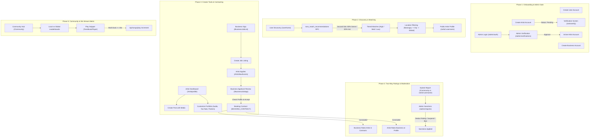

# TONO End-to-End User Flow & Demonstration Plan

## Goal Description
Provide an exhaustive, step-by-step implementation, testing, and presentation plan for the TONO web application. This plan orchestrates the full platform lifecycle across all three primary user roles (**User/Fan**, **Artist**, and **Business Host**) and the **Admin Moderation Suite**, verifying all critical database RPCs, authentication gates, contracting lifecycles, and audio streaming metrics.

---

## Architecture & Flow Overview



---

## Detailed Step-by-Step Flow Execution Plan

### Step 1: Create Accounts (User, Artist, Business)
* **File:** [`app/pages/Signin.vue`](file:///d:/Documents/Code/TONO/app/pages/Signin.vue)
* **Composable:** [`useTonoAuth.ts`](file:///d:/Documents/Code/TONO/app/composables/useTonoAuth.ts) (`signUpWithTonoAccount`)
* **Actions:**
  1. **Regular User Account:**
     * Navigate to `/Signin`.
     * Fill in credentials: Email (e.g. `fan@tono.ph`), Username (`tonofan`), City (*Naga City*), Barangay (*Concepcion Pequeña*), Password.
     * Select Role: **User**.
     * Toggle **"Are you a business owner?"** to **OFF** (sets `isBusinessOwner: false`).
     * Select preferred genres (e.g. *Indie Rock, Acoustic*) and instruments.
     * Submit &rarr; redirects to `/Login`.
  2. **Business Host Account:**
     * Navigate to `/Signin`.
     * Fill in credentials: Email (e.g. `host@tono.ph`), Username (`cafeblue`), City (*Naga City*), Barangay (*Concepcion Grande*), Password.
     * Select Role: **User** &rarr; toggle **"Are you a business owner?"** to **ON**.
     * Fill in Business Profile details:
       * Business Name: *The Blue Room Acoustic Cafe*
       * Business Address: *Magsaysay Avenue, Naga City*
       * Business Service: *Live Acoustic Music & Cafe*
       * Phone: `+63 912 345 6789`
     * Submit &rarr; stores records in both `USER_ACCOUNT` and `BUSINESS_PROFILE`.
  3. **Artist Account (Solo or Band):**
     * Navigate to `/Signin`.
     * Fill in credentials: Email (e.g. `artist@tono.ph`), Username (`mayari`), City (*Naga City*), Barangay (*Concepcion Pequeña*), Password.
     * Select Role: **Artist** &rarr; choose **Solo** (or Band).
     * Fill in Artist details:
       * Stage Name: *Mayari*
       * Specialty: *Singer-Songwriter*
       * Bio: *Indie folk singer-songwriter based in Naga City.*
     * Select genres (e.g. *Indie Rock, Folk, Acoustic*) and instruments (e.g. *Acoustic Guitar, Vocals*).
     * Submit &rarr; inserts `ARTIST` row with `Status = 'Pending'` and `Is_Verified = false`.

---

### Step 2: Login as Artist & Show Verification Screen
* **Files:** [`app/pages/Login.vue`](file:///d:/Documents/Code/TONO/app/pages/Login.vue), [`app/middleware/artist.ts`](file:///d:/Documents/Code/TONO/app/middleware/artist.ts), [`app/pages/artistverify.vue`](file:///d:/Documents/Code/TONO/app/pages/artistverify.vue)
* **Actions:**
  1. Open `/Login` and submit the Artist credentials (`mayari`).
  2. The router attempts to navigate to `/Artisthome`.
  3. `app/middleware/artist.ts` checks `profile.artistProfile.Status !== 'Active'`.
  4. Automatically redirects to `/artistverify`.
  5. The **Pending Verification** screen is displayed, highlighting that the profile has been submitted and is currently locked under review by the moderation team.
  6. Point out the interactive **Refresh Status** button.

---

### Step 3: Introduce Admin & Verify Artist
* **Files:** [`app/pages/admin/auth/index.vue`](file:///d:/Documents/Code/TONO/app/pages/admin/auth/index.vue), [`app/pages/admin/verifications.vue`](file:///d:/Documents/Code/TONO/app/pages/admin/verifications.vue)
* **Actions:**
  1. Open a new incognito window and go to `/admin/auth`.
  2. Log in with administrative credentials.
  3. Redirects to `/admin/dashboard`. Click **Verifications** in the sidebar (`/admin/verifications`).
  4. Find the pending application for *Mayari*.
  5. Click to inspect the stage name, bio, social links, location, and genres.
  6. Click **Approve**.
  7. Supabase updates:
     ```sql
     UPDATE "ARTIST" 
     SET "Is_Verified" = true, "Status" = 'Active' 
     WHERE "ARTIST_ID" = '...'
     ```

---

### Step 4: Login to Artist & User Discovery (Jaccard Similarity + Location Filtering)
* **Files:** [`app/pages/userhome.vue`](file:///d:/Documents/Code/TONO/app/pages/userhome.vue), [`app/composables/useTonoMatching.ts`](file:///d:/Documents/Code/TONO/app/composables/useTonoMatching.ts), [`tono_match_recommendations`](file:///d:/Documents/Code/TONO/supabase/migrations/20260920160000_enable_public_artist_profiles_and_update_rpc.sql)
* **Actions:**
  1. Switch back to the Artist window &rarr; click **Refresh Status** on `/artistverify`. The artist is granted immediate entry into the **Artist Dashboard** (`/Artisthome`).
  2. In the User session, log in as `tonofan` &rarr; lands on `/userhome`.
  3. The newly verified artist (*Mayari*) appears in the Discovery Feed.
  4. **Jaccard Similarity Brief Explanation:**
     * The matching engine computes the set similarity ratio between the requester's preferences and the artist's tags:
       $$J(A, B) = \frac{|A \cap B|}{|A \cup B|}$$
     * **Discovery Context Weighting:**
       $$\text{Total Score} = 0.8 \times \text{Genre Score} + 0.2 \times \text{Instrument Score}$$
     * **Tiers:**
       * **High Match:** $\ge 70\%$ (emerald badge)
       * **Medium Match:** $30\% - 69\%$ (indigo badge)
       * **Low Match:** $> 0\% - 29\%$ (zinc badge)
  5. **Location Filtering Demonstration:**
     * **Level 1 (Barangay):** Automatically isolates artists sharing both Barangay (*Concepcion Pequeña*) and City (*Naga City*).
     * **Level 2 (City Fallback):** If no direct barangay peers exist, expands candidates to the entire city.
     * **Level 3 (Global Toggle):** Clicking the location filter toggle switches `p_apply_location_filter` to `false`, pulling all platform artists.

---

### Step 5: Public Artist Profile View & Tab Showcase
* **File:** [`app/pages/artist/[username].vue`](file:///d:/Documents/Code/TONO/app/pages/artist/%5Busername%5D.vue) &rarr; `/artist/mayari`
* **Actions:**
  1. On `/userhome`, click on *Mayari*'s discovery card or name.
  2. Navigates directly to `/artist/mayari`.
  3. Demonstrate the public tabs:
     * **Posts Tab:** Timeline feed of updates, media highlights, and comments.
     * **Events (Gigs) Tab:** Upcoming confirmed public gigs displaying date badges, venue, and time.
     * **Portfolio Tab:** Featured audio snippet, YouTube media player embeds, promotional posters, and career milestones.
     * **Contact Tab:** Contact details, Direct Booking CTA button, and social links.

---

### Step 6: Artist Profile Management (Post Creation & Portfolio Customization)
* **Files:** [`app/pages/Artistprofile.vue`](file:///d:/Documents/Code/TONO/app/pages/Artistprofile.vue), [`ArtistCreatePostModal.vue`](file:///d:/Documents/Code/TONO/app/components/ArtistCreatePostModal.vue)
* **Actions:**
  1. As Artist, navigate to **My Profile** (`/Artistprofile`).
  2. **Create Post:**
     * In the Posts tab, click **Create Post**.
     * Add caption: *"Working on new acoustic material for upcoming gigs in Naga City! 🎸"*.
     * Attach an image or leave text-only, and submit. The post appears instantly in both the profile and Community Feed.
  3. **Customize Portfolio:**
     * Click the **Portfolio** tab.
     * Click **Add Track** &rarr; upload an audio snippet or trim an intro.
     * Click **Add Media** &rarr; insert a YouTube video URL (e.g. live performance).
     * Add promotional posters and career milestones.

---

### Step 7: Business Creates Job Listing
* **File:** [`app/pages/BusinessJobList.vue`](file:///d:/Documents/Code/TONO/app/pages/BusinessJobList.vue) &rarr; `/BusinessJobList`
* **Actions:**
  1. In the Business session (`cafeblue`), go to **Job Listings** (`/BusinessJobList`).
  2. Click **Create Listing**.
  3. Enter gig parameters:
     * Event Title: *Acoustic Saturday Live*
     * Date: Upcoming weekend
     * Time: `19:00 - 22:00`
     * Location: *Magsaysay Ave, Naga City*
     * Compensation Fee: `₱3,500`
     * Slots: `1`
     * Requested Song Lineup: e.g. *3 sets of indie acoustic & folk originals/covers*.
  4. Submit &rarr; Listing is published with status `Active` and code `JB-MMDD01-YYYY`.

---

### Step 8: Artist Applies & Business Reviews Portfolio & Approves
* **Files:** [`app/pages/ArtistNavEvents.vue`](file:///d:/Documents/Code/TONO/app/pages/ArtistNavEvents.vue), [`JobDetailsModal.vue`](file:///d:/Documents/Code/TONO/app/components/JobDetailsModal.vue), [`app/pages/BusinessJobApp.vue`](file:///d:/Documents/Code/TONO/app/pages/BusinessJobApp.vue)
* **Actions:**
  1. In the Artist session, navigate to **Gigs & Events** (`/ArtistNavEvents`).
  2. Click on *Acoustic Saturday Live* to open [`JobDetailsModal.vue`](file:///d:/Documents/Code/TONO/app/components/JobDetailsModal.vue).
  3. Submit proposal with pitch: *"I'd love to perform our acoustic set at The Blue Room!"* with proposed fee `₱3,500`.
  4. In the Business session, navigate to **Job Applications** (`/BusinessJobApp`).
  5. Expand the *Acoustic Saturday Live* accordion:
     * View *Mayari*'s application card, pitch message, and proposed fee.
     * Click **Check Profile** &rarr; opens `/artist/mayari` in a new tab.
     * Demonstrate that the portfolio links, audio, and YouTube embeds work smoothly for the host review.
     * Return to `/BusinessJobApp` and click **Accept**.
  6. System transitions the application to `Accepted`, generates a `BOOKING_CONTRACT` with status `Pending_Artist_Approval`, and decrements open gig slots.
  7. In the Artist session, open notification &rarr; review [`ArtistContractModal.vue`](file:///d:/Documents/Code/TONO/app/components/ArtistContractModal.vue), finalize custom setlist, and approve the contract.

---

### Step 9: Two-Way Rating System
* **Files:** [`app/pages/BusinessContracts.vue`](file:///d:/Documents/Code/TONO/app/pages/BusinessContracts.vue), [`app/pages/Artistprofile.vue`](file:///d:/Documents/Code/TONO/app/pages/Artistprofile.vue), [`ReviewModal.vue`](file:///d:/Documents/Code/TONO/app/components/ReviewModal.vue)
* **Composable:** [`useTonoReviews.ts`](file:///d:/Documents/Code/TONO/app/composables/useTonoReviews.ts)
* **Actions:**
  1. Once the contract concludes (or is marked as completed in testing):
  2. **Business Rates Artist:**
     * In `/BusinessContracts`, locate the completed booking card.
     * Click **Rate Performer** &rarr; [`ReviewModal.vue`](file:///d:/Documents/Code/TONO/app/components/ReviewModal.vue) opens.
     * Give a 5-star rating with review: *"Exceptional performance and professional setup!"*.
  3. **Artist Rates Business:**
     * In `/Artistprofile` under the **Events & Gigs** tab, locate the completed gig.
     * Click **Rate Host / Client** &rarr; [`ReviewModal.vue`](file:///d:/Documents/Code/TONO/app/components/ReviewModal.vue) opens.
     * Give a 5-star rating with review: *"Great sound system, hospitable staff, and prompt payment!"*.

---

### Step 10: Reports, Cancellations, and Admin Sanctions
* **Files:** [`ReportModal.vue`](file:///d:/Documents/Code/TONO/app/components/ReportModal.vue), [`app/pages/admin/reports.vue`](file:///d:/Documents/Code/TONO/app/pages/admin/reports.vue)
* **Composable:** [`useModerationReport.ts`](file:///d:/Documents/Code/TONO/app/composables/useModerationReport.ts)
* **Actions:**
  1. **Reporting a Post / Profile / Cancellation:**
     * On a post in `/Community` or on an artist profile, click **Report**.
     * [`ReportModal.vue`](file:///d:/Documents/Code/TONO/app/components/ReportModal.vue) opens with target details prefilled.
     * Show report categories (Spam, Harassment, Inappropriate Content, or Proximity Contract Cancellation).
     * Submit report.
  2. **Admin Dashboard Resolution:**
     * In the Admin session, navigate to **Reports** (`/admin/reports`).
     * Inspect the report evidence snapshot, timeline, and offender history.
     * Demonstrate sanction options:
       * **Issue Official Warning**
       * **Apply Rating Penalty Deduction** (e.g. `-0.5` rating penalty)
       * **Temporary Suspension** (e.g. 7-day restriction)
       * **Account Ban** or **Dismiss Report**.

---

### Step 11: Community Tab & Music Stream Metrics (30-Second Rule)
* **Files:** [`app/pages/Community.vue`](file:///d:/Documents/Code/TONO/app/pages/Community.vue), [`TonoMusicPlayer.vue`](file:///d:/Documents/Code/TONO/app/components/TonoMusicPlayer.vue)
* **Composable & API:** [`useTonoSongs.ts`](file:///d:/Documents/Code/TONO/app/composables/useTonoSongs.ts), [`server/api/songs/play.post.ts`](file:///d:/Documents/Code/TONO/server/api/songs/play.post.ts)
* **Actions:**
  1. As User, navigate to **Community** (`/Community`).
  2. Browse local feed posts and view the **Top Charts / Leaderboards**.
  3. Toggle between **Local** and **All** to show city-scoped music filtering.
  4. **Play Audio Snippet:**
     * Click **Play** on any track.
     * The floating player [`TonoMusicPlayer.vue`](file:///d:/Documents/Code/TONO/app/components/TonoMusicPlayer.vue) docks at the bottom.
  5. **Like Song:**
     * Click the heart icon in the player or leaderboard row to immediately toggle like status and increment `Like_Count`.
  6. **30-Second Stream Verification Rule:**
     * Observe the circular progress ring around the play button.
     * Explain that TONO implements fraud-protected stream validation: scrubbing or skipping does not increment play counts.
     * When 30 seconds of active wall-clock playback is reached, `recordVerifiedPlay()` calls `/api/songs/play`, registering 1 legitimate stream and updating `Play_Count` live.

---

## Verification Plan

### Automated Build Check
```powershell
npm run build
```

### Manual Verification Checklist
- [ ] User, Business, and Artist accounts create cleanly with respective profile rows.
- [ ] Artist is locked on `/artistverify` until approved.
- [ ] Admin approval in `/admin/verifications` unlocks the artist account in realtime.
- [ ] Jaccard similarity and location filtering compute correctly on `/userhome`.
- [ ] Public artist profile displays all 4 primary tabs (Posts, Events, Portfolio, Contact).
- [ ] Media embeds (YouTube / Spotify) and audio snippets render and play correctly.
- [ ] Job listing created by Business is visible and apply-able by Artist.
- [ ] Accepting application generates a `Pending_Artist_Approval` booking contract.
- [ ] Two-way ratings submit and update rating tables.
- [ ] Moderation reports appear in `/admin/reports` with sanction capability.
- [ ] 30 seconds of audio playback registers exactly 1 verified play in `/api/songs/play`.
